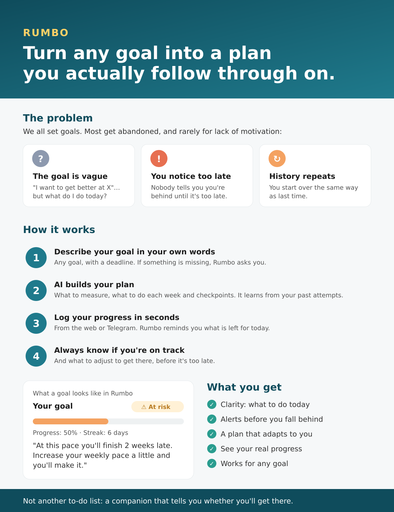
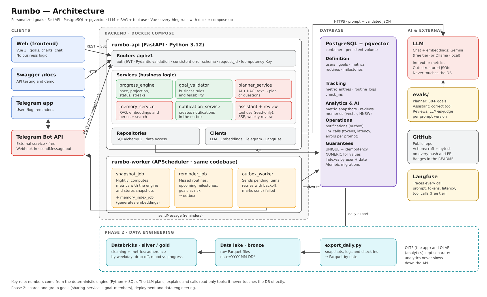

# Rumbo

**Turn any goal into a measurable plan, and always know if you're on track.**

Rumbo is an AI-powered goal tracking app. You describe any goal in natural language; an LLM turns it into a structured plan (metrics, routines and milestones), and a deterministic engine tracks your progress, projects when you'll get there and warns you before you fall behind.

> 🚧 **Status:** in active development. See the [roadmap](#roadmap) for what's done and what's next.

🔗 **Project page:** https://JLP-0.github.io/rumbo



---

## Why

Most goals are abandoned, and rarely for lack of motivation:

- **The goal is vague.** It never becomes "what do I do today?"
- **You notice too late.** Nothing tells you you're behind until it's too late to recover.
- **History repeats.** Apps don't learn from your previous attempts.
- **One size fits none.** Most apps assume a fixed type of goal (habits, fitness, savings).

Rumbo works for **any** goal by reducing it to four generic building blocks and computing real progress metrics on top of them.

---

## Features

- **Natural-language goal planning:** an LLM converts free text into a validated plan using structured outputs, or asks clarifying questions when key information is missing.
- **Generic goal model:** no goal types hardcoded. Every goal is expressed as *metrics* (cumulative, target value, frequency, milestone, scale), *routines* (with flexible cadences) and *milestones*.
- **Progress engine:** required vs actual pace, projected completion date, status (`on_track`, `at_risk`, `off_track`), routine adherence and streaks, computed in Python and SQL (window functions, gaps-and-islands).
- **RAG over your own history:** past goals, retrospectives and notes are embedded with pgvector so the planner learns from your previous attempts.
- **AI assistant with tool calling:** ask about your progress; the assistant calls read-only tools scoped to the authenticated user, with streaming responses.
- **Reminders:** a nightly job detects missed routines and goals at risk and delivers them through a Telegram bot using the outbox pattern.
- **LLM evaluation:** datasets and runners to measure planner quality per prompt version, plus LLM-as-a-judge for weekly reviews.
- **Observability:** request IDs, structured logs and LLM tracing (tokens, latency, errors per prompt version).

---

## Architecture



**Key design rule:** numbers always come from the deterministic engine. The LLM plans, explains and calls read-only tools; it never computes metrics or touches the database directly.

---

## Tech stack

| Area | Tools |
|---|---|
| API | Python 3.12, FastAPI, Pydantic v2 |
| Data | PostgreSQL 16, pgvector, SQLAlchemy 2, Alembic |
| AI | LLM and embeddings behind provider interfaces (Gemini / Ollama), structured outputs, RAG, tool calling, evals, Langfuse |
| Jobs | APScheduler, outbox pattern |
| Auth | JWT, Argon2 password hashing |
| Frontend | Vue 3, Vite, Chart.js |
| Quality | pytest, Ruff, GitHub Actions |
| Infra | Docker, Docker Compose |

---

## Getting started

**Requirements:** Docker, [uv](https://docs.astral.sh/uv/) and Python 3.12.

```bash
git clone https://github.com/jlp-0/rumbo.git
cd rumbo

# 1. Configure environment variables
cp api/.env.example api/.env
# edit api/.env and set JWT_SECRET_KEY

# 2. Start the database
docker compose up -d db

# 3. Install dependencies and run migrations
cd api
uv sync
uv run alembic upgrade head

# 4. Run the API
uv run fastapi dev app/main.py
```

Open the interactive docs at **http://localhost:8000/docs**.

**Run everything in Docker:**
```bash
docker compose up --build
docker compose exec api alembic upgrade head
```

**Tests and linting:**
```bash
cd api
uv run pytest -v
uv run ruff check .
```

---

## API overview

| Method | Endpoint | Description |
|---|---|---|
| GET | `/health` | API and database health |
| POST | `/api/v1/auth/register` | Create an account |
| POST | `/api/v1/auth/login` | Get a JWT access token |
| GET | `/api/v1/users/me` | Current user |
| POST | `/api/v1/goals/plan` | 🚧 Natural language → plan draft or clarifying questions |
| POST | `/api/v1/goals` | 🚧 Create a confirmed goal |
| GET | `/api/v1/dashboard` | 🚧 Goals at risk, streaks, today's pending items |
| POST | `/api/v1/assistant/chat` | 🚧 Tool-calling assistant (SSE) |

Every error follows the same schema:
```json
{ "error": { "code": "NOT_FOUND", "message": "Goal not found", "request_id": "..." } }
```

---

## Project structure

```
rumbo/
├── api/
│   ├── app/
│   │   ├── core/          # config, database, security, errors, logging
│   │   ├── api/v1/        # HTTP routers (thin)
│   │   ├── schemas/       # Pydantic request/response contracts
│   │   ├── models/        # SQLAlchemy models
│   │   ├── repositories/  # data access
│   │   ├── services/      # business logic, progress engine, AI services
│   │   ├── clients/       # LLM, embeddings, Telegram, tracing
│   │   ├── tools/         # assistant tools (read-only)
│   │   ├── prompts/       # versioned prompts
│   │   └── jobs/          # scheduled jobs
│   ├── evals/             # LLM evaluation datasets and runners
│   ├── migrations/        # Alembic
│   └── tests/             # unit and integration tests
├── web/                   # Vue 3 frontend
├── docs/                  # GitHub Pages site and images
└── docker-compose.yml
```

Request flow: `router → service → repository → database`. Routers handle HTTP, services own business rules and transactions, repositories own queries.

---

## Design decisions

- **Generic schema instead of goal types:** flexibility lives in `kind`, `aggregation` and `cadence`, so new kinds of goals need no code changes.
- **Deterministic engine + LLM:** metrics are reproducible and testable; the LLM is used only where language is needed (planning, explaining, answering).
- **Two-layer validation of LLM output:** Pydantic schema validation, then business rules and feasibility checks, with one retry using the error as feedback.
- **pgvector inside PostgreSQL:** fewer moving parts and per-user filtering in the same query as the vector search.
- **Idempotency enforced by the database:** unique constraints prevent duplicate entries on retries.
- **Outbox pattern for notifications:** a failed delivery is retried, never lost.
- **Domain exceptions + global handlers:** services stay independent of HTTP and every error has a consistent shape.

---

## Roadmap

**Phase 1**
- [x] Project setup: FastAPI, PostgreSQL, Docker Compose, Alembic
- [x] Health check, consistent error handling, request ID middleware
- [x] JWT authentication (register, login, current user)
- [ ] Goals, metrics, routines, milestones and progress logging
- [ ] Progress engine (pace, projection, status, streaks) with tests
- [ ] LLM planner with structured outputs and validation
- [ ] Planner evals
- [ ] RAG over user history (pgvector)
- [ ] Tool-calling assistant with streaming and guardrails
- [ ] Scheduled jobs, outbox and Telegram reminders
- [ ] Vue frontend
- [ ] CI with GitHub Actions

**Phase 2**
- [ ] Shared and group goals
- [ ] Deployment
- [ ] Analytics pipeline (Parquet → Databricks)

---

## Author

**Jefferson López Porras**: Backend Engineer (Python, SQL, APIs, LLM integration).
[LinkedIn](https://www.linkedin.com/in/jeff-lp) · [GitHub](https://github.com/JLP-0)
